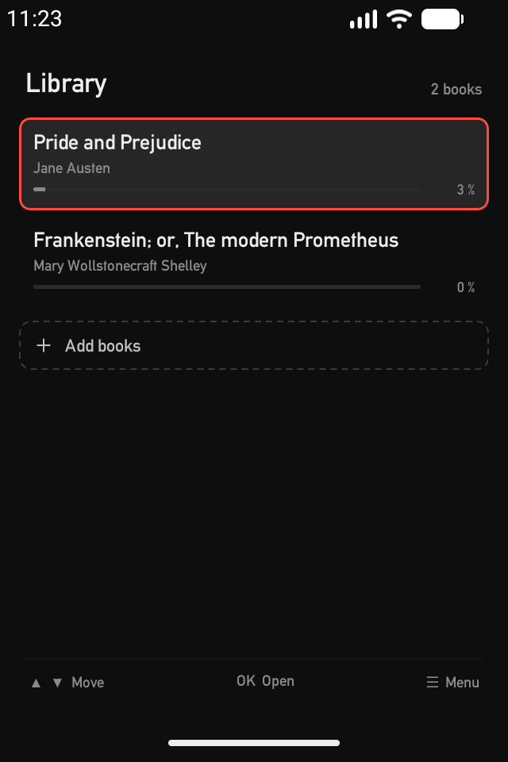
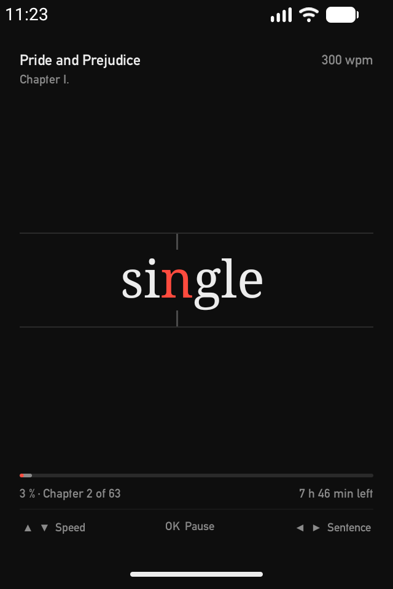
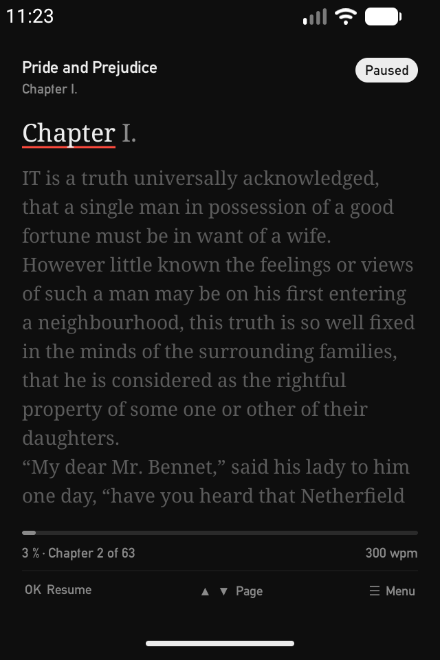
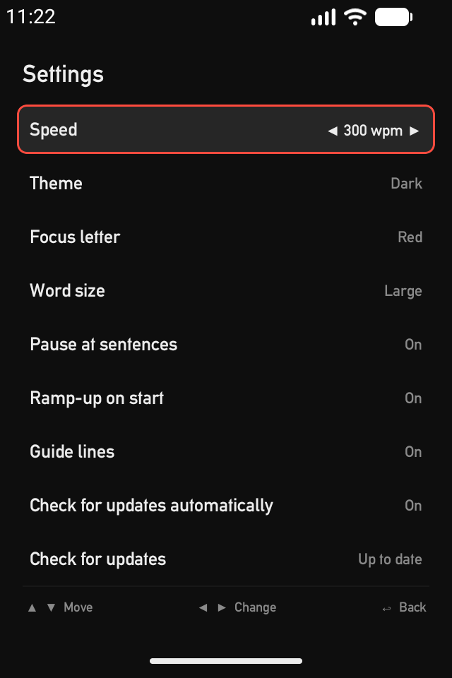

# my-rsvp

An e-reader for Android that shows a book **one word at a time** (RSVP, Rapid Serial Visual
Presentation). The focus letter of every word stays at the same spot, so your eyes don't move.

Built first for the **Qin F22 Pro** keypad phone (3.5″, 640 × 960, D-pad), and just as usable
on normal touch phones.

<p>
  
  
  
  
</p>

## Features

- **RSVP reader** with a fixed focus letter, natural word timing (longer words, pauses at
  commas, sentences and paragraphs), ramp-up after start, 100–900 words per minute.
- **Paused view as a page**: the current sentence with the current word marked, the following
  text below; ▲▼ turn pages, ◀▶ jump by sentence.
- **Progress** for the whole book and the current chapter in one bar, plus the time left.
- **EPUB and TXT import** (several files at once). Chapters from the table of contents, or from
  "Chapter 3" lines in text files. Project Gutenberg books are cleaned up automatically.
- **Library** sorted by last read, reading position saved per book.
- **Settings**: speed, dark/light theme, focus color, word size, pause at sentences, ramp-up,
  guide lines.
- **100 % button-navigable**: every screen works with the D-pad alone. Touch gestures in the
  reader mirror the keys (tap = OK, swipe = arrow, long press = menu), and the key hints at the
  bottom can be tapped too.
- **Updates from GitHub**: the app looks for new releases, shows the changelog and installs the
  new version.

## Install

Download the APK from the [latest release](https://github.com/dahunni/myrsvp/releases/latest)
and open it on the phone (Android 8 or newer). Android asks once to allow installing apps from
your browser or file manager. Later versions are offered by the app itself.

## Privacy

No accounts, no ads, no analytics, no tracking. Books, settings and reading positions stay on
the device and are excluded from cloud backups.

The only network access is the update check: the app asks the GitHub API for the latest
release of this repository (at most every 6 hours) and downloads the APK when you choose to
install it. GitHub sees your IP address and the app version, as for any visit to GitHub. The
automatic check can be switched off in Settings.

## Build

Requirements: JDK 25 (Android Studio's bundled JDK works) and the Android SDK with platform 37.

```bash
./gradlew assembleDebug          # debug APK in app/build/outputs/apk/debug/
./gradlew testDebugUnitTest      # unit tests
./gradlew installDebug           # install on a connected phone or emulator
```

If `java` isn't on your PATH, point `JAVA_HOME` at Android Studio's JDK, e.g. on macOS
`/Applications/Android Studio.app/Contents/jbr/Contents/Home`.

Releases are built by GitHub Actions when a release is published; see
[docs/RELEASE.md](docs/RELEASE.md). Forks can point the updater at their own repository with
`-PupdateRepository=owner/name`.

## Project layout

```
app/src/main/java/de/dahunni/myrsvp/
  engine/   pure Kotlin: tokenizer, focus letter, word timing, sentence index, playback state
  book/     EPUB and TXT import, the internal book format, the library on disk
  data/     settings and reading progress (DataStore)
  input/    all key codes, key hints and touch gestures → app actions, in one place
  update/   GitHub release check, download and install
  ui/       Compose screens: reader, library, menu, settings, info, update, theme
```

- [docs/SPEC.md](docs/SPEC.md): features, reading rules, controls, book import
- [docs/DESIGN.md](docs/DESIGN.md): colors, type and layout of every screen
- [design/mockups/](design/mockups/): the approved mockups
- [docs/RELEASE.md](docs/RELEASE.md): how releases are made

## License

Copyright (C) 2026 Tim Hunneck

my-rsvp is free software: you can redistribute it and/or modify it under the terms of the
GNU General Public License as published by the Free Software Foundation, either version 3 of
the License, or (at your option) any later version. See [LICENSE](LICENSE).

### Third-party

- [jsoup](https://jsoup.org/), MIT License
- AndroidX, Jetpack Compose, Kotlin and kotlinx.serialization, Apache License 2.0
- Alte DIN 1451 Mittelschrift by [Peter Wiegel](http://www.peter-wiegel.de/), SIL Open Font
  License 1.1 (`app/src/main/assets/licenses/`)
- The reading rules (focus letter, word timing, sentence pauses) are adapted from
  [RSVP Nano](https://github.com/ionutdecebal/rsvpnano) and
  [pocket-reader](https://github.com/laurensvanhelvoort/pocket-reader), both MIT License.

All license texts are also shown in the app under Settings → About & licenses.
